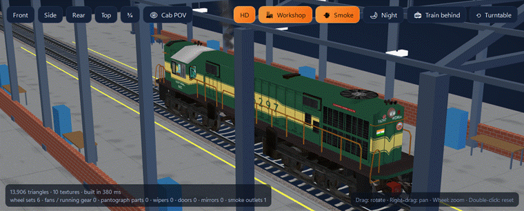
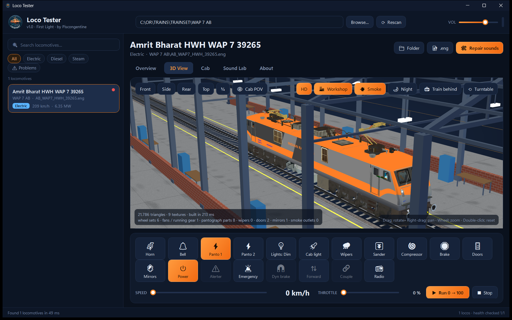
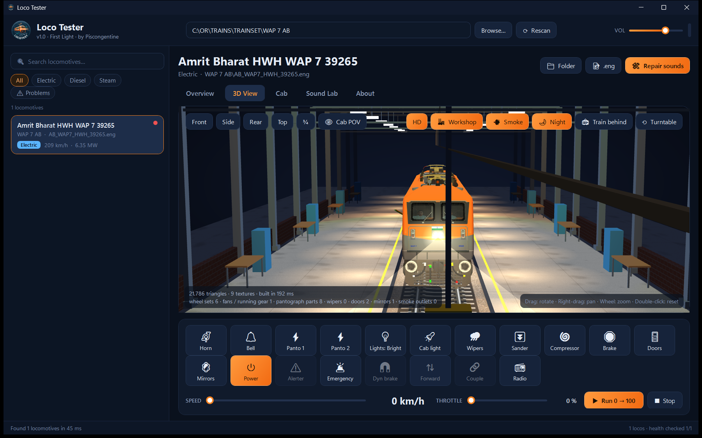
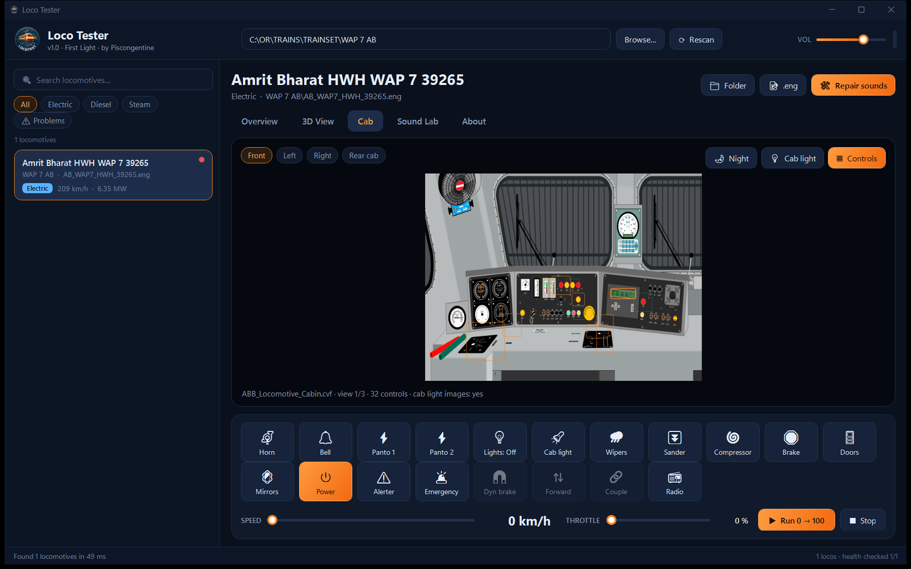
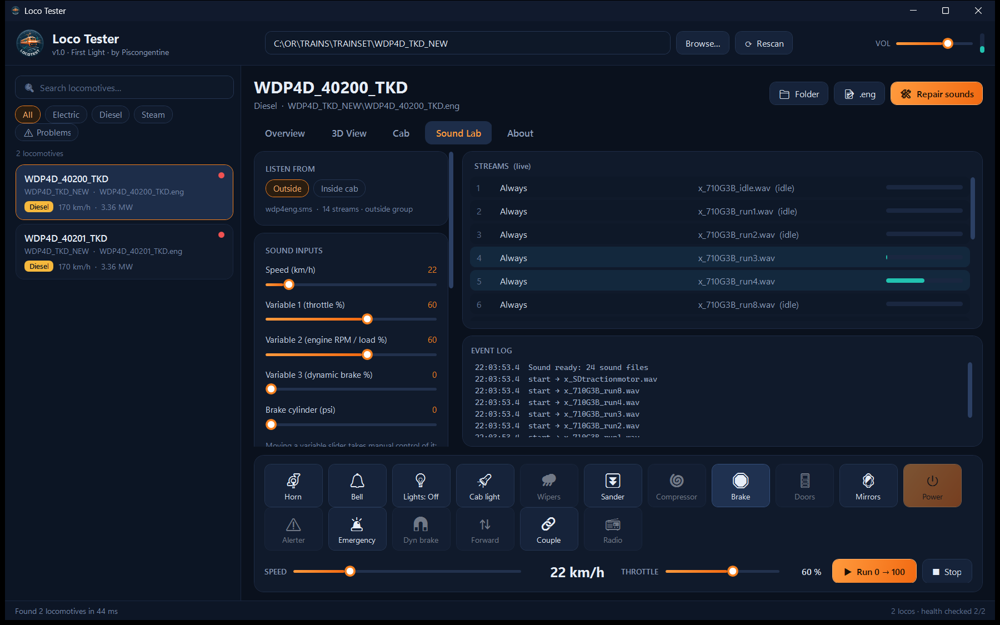
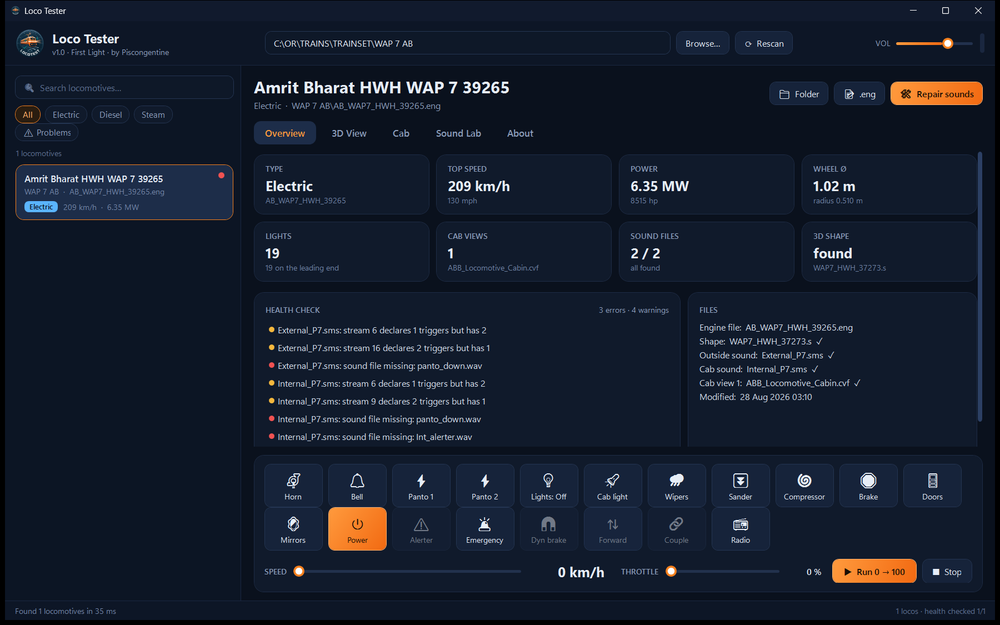
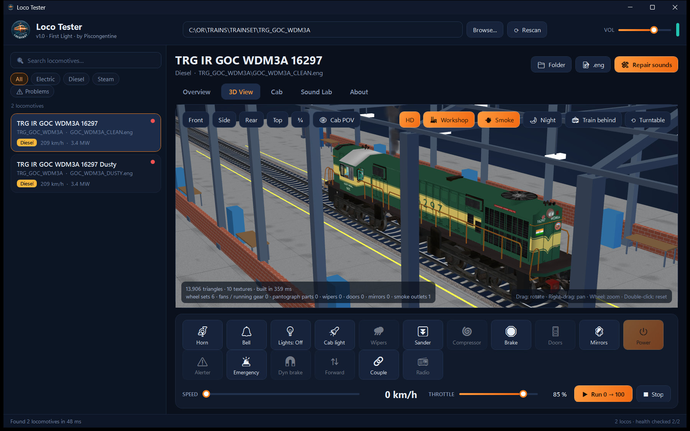
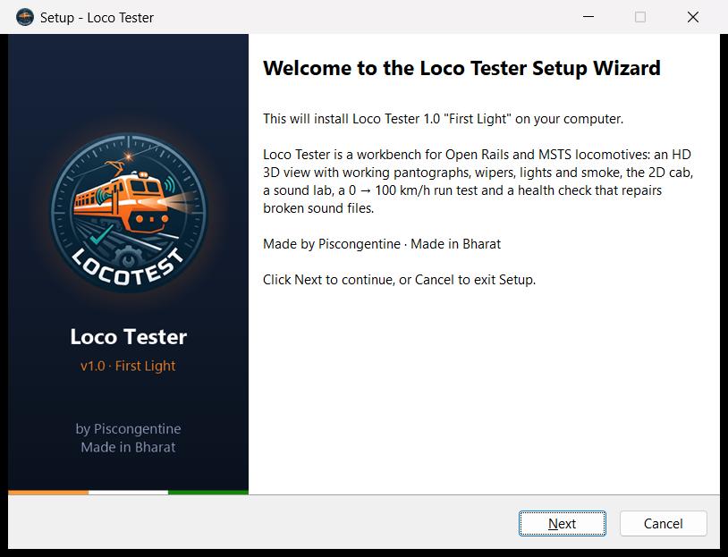

<p align="center">
  
</p>

<p align="center">
  <a href="https://github.com/piscongentine/loco-tester-openrails/releases/latest/download/LocoTester-Setup-1.0.exe"></a>
  <a href="https://github.com/piscongentine/loco-tester-openrails/releases"></a>
  
  
</p>

<p align="center"><b>Look at it. Listen to it. Drive it. Fix it.</b><br>
Point Loco Tester at your Open Rails or MSTS folder and every locomotive is ready to test in a second:<br>
an HD 3D model in a loco shed, its own lights, smoke and pantographs, the 2D cab, every sound in its <code>.sms</code>,<br>
a 0 → 100 km/h run, and a health check that repairs broken sound files for you.</p>

---

<p align="center">
  
  
</p>

## ✨ Features

| | |
|---|---|
| 🚂 **Every loco in a second** | Scans `TRAINS\TRAINSET` in parallel (100+ locos in ~0.1 s), with search and Electric / Diesel / Steam / Problems filters. |
| 🩺 **Health check** | Finds missing or broken `.sms` files, missing `.wav` files, damaged brackets, wrong counts, missing shapes and cab files, for every loco in the background. |
| 🛠 **One-click sound repair** | Backs up first, then rebuilds missing or empty sound files from the closest healthy loco of the same type, fixes brackets, headers and counts, and finds renamed sounds. |
| 🧊 **HD 3D view** | The real `.s` model and `.ace` textures at full resolution, standing on the real **DB Tracks** track inside a loco shed, or on open track. Rotate, pan, zoom, preset cameras, turntable and a driver's-eye view. |
| ⚡ **Things that move** | Wheels, radiator fans, steam rods, pantographs (with sparks at the contact wire), wipers, doors and mirrors, all driven by speed and the test buttons. |
| 💡 **Real lights** | Lights from the `.eng`: dim and bright headlights at the end you drive toward, red tail lights, marker and blinking lights, emergency (penalty) lights. Glare, beams and a real night mode. |
| 💨 **Smoke and steam** | Diesel exhaust that thickens and darkens with the throttle; steam chimney, whistle and cylinder steam. |
| 🎛 **2D cab** | Day, night and cab-light pictures. Click the horn, bell, sander, wipers, pantograph, brake and more right on the cab. |
| 🔊 **Sound Lab** | Plays the `.sms` the way Open Rails does: cue-point loops, speed and engine-RPM curves, every trigger as a button, live stream meters and an event log. |
| 🏁 **Run 0 → 100** | Speeds up, cruises and brakes to a stop while you hear every sound stage. |
| 🧪 **Tests** | Horn, bell, pantographs, lights, wipers, sander, compressor, brake, emergency brake, dynamic brake, reverser, doors, mirrors, coupling, power, alerter, radio, plus injectors, blower, cylinder cocks, fire door and safety valve on steam locos. |
| 🔎 **Check this PC** | Requirements, graphics card and driver, sound, Open Rails folders and DB Tracks, in the setup and inside the app. |

## 📸 Screens

<p align="center">
  
  
  
  
  
  
</p>

## ⬇️ Install

1. Download **[LocoTester-Setup-1.0.exe](https://github.com/piscongentine/loco-tester-openrails/releases/latest/download/LocoTester-Setup-1.0.exe)** (about 3 MB).
2. Run it. It installs for your Windows account and needs no administrator rights.
3. On the last page, tick **Check this PC** to see whether your graphics card, sound and Open Rails folder are ready.

> **"Windows protected your PC"?** Loco Tester is new and not code-signed yet, so SmartScreen does not know it. Click **More info → Run anyway**. The source code is all here if you want to check or build it yourself.

<p align="center"></p>

### Requirements

| | Needed | Notes |
|---|---|---|
| Windows | 10 or 11 | 64-bit recommended |
| .NET Framework | 4.8 | Built into Windows 10 (1903+) and 11. Setup tells you if it is missing. |
| Graphics | DirectX hardware 3D | For the HD 3D preview. Keep the driver up to date. The **HD** button can be turned off on slow PCs. |
| Sound | any output | Everything else works without sound. |
| Content | Open Rails or MSTS folder with `TRAINS\TRAINSET` | Found automatically on first start. |
| Optional | [DB Tracks](https://www.trainsim.com/) in `GLOBAL\SHAPES` | Gives the real track under the loco; without it a simple track is drawn. |

## 🎮 Keys

| Key | Action | Key | Action |
|---|---|---|---|
| `H` (hold) | Horn | `B` (hold) | Bell |
| `P` / `Shift+P` | Pantograph 1 / 2 | `L` | Headlights off / dim / bright |
| `C` | Cab light | `W` | Wipers |
| `Space` (hold) | Brake | `E` | Emergency brake |
| `Y` (hold) | Dynamic brake | `V` | Reverser |
| `S` / `K` | Sander / Compressor | `D` / `M` | Doors / Mirrors |
| `O` | Power | `J` | Couple / uncouple |
| `R` | Run 0 → 100 | `Esc` | Stop |
| `↑` `↓` | Throttle | `PgUp` `PgDn` | Speed |
| `1`–`5` | Pages | `Ctrl+F` / `F5` | Search / Rescan |

## 🛠 Sound repair: what it changes

Before anything is touched, the loco's `.eng` and `.sms` files are copied to `<loco folder>\LocoTester_Backup\<date_time>\`. Then it can:

- recreate a missing or empty `.sms` from the closest healthy loco of the same type (with its sounds),
- add missing `Sound ( )` lines to the `.eng`,
- repair cut-off files and misplaced or extra brackets,
- restore the `SIMISA` header and remove corrupt characters,
- correct `Streams` / `Triggers` / `CurvePoints` counts,
- point renamed sound files at the right `.wav`.

`.wav` files are never changed, only added. Shared sounds in the global `SOUND` folder are never edited. To undo, copy the backup files back.

## 🧱 Build from source

Everything is plain C# 5 / WPF on .NET Framework 4.8, compiled with the C# compiler that ships with Windows. No Visual Studio or SDK needed.

```powershell
.\build.ps1          # builds build5\Loco Tester.exe
.\build-setup.ps1    # builds dist\LocoTester-Setup-1.0.exe (needs Inno Setup 6)
```

Self-tests:

```powershell
& ".\build5\Loco Tester.exe" --selftest C:\OR\TRAINS\TRAINSET        # makes damaged LT_DUMMY_* copies, repairs and checks them
& ".\build5\Loco Tester.exe" --soundtest "C:\OR\TRAINS\TRAINSET\<loco>\<loco>.eng" C:\OR
```

| Folder | What is in it |
|---|---|
| `src/` | The app: file readers (`Stf`, `Loco`, `Sms`, `Shape`, `TextShape`, `Cab`), sound (`Audio`, `SoundSim`), 3D (`Viewer3D`, `Lights`, `Smoke`, `Scenery`), repair (`Repair`, `SelfTest`), UI (`Gui`, `MainWindow.xaml`) |
| `installer/` | Inno Setup script and wizard artwork |
| `assets/` | Logo and icon |
| `docs/` | README banner, screenshots and animations |

## 📜 Licence

Free to use, share and modify. Modified versions must keep the copyright notice, must be renamed (not "Loco Tester"), must not use the logo or the name Piscongentine, must say they are based on Loco Tester, and must not be sold. See [LICENSE.txt](LICENSE.txt).

---

<p align="center">
  Made with ❤️ by <b>Piscongentine</b> · Made in Bharat 🇮🇳<br>
  <sub>Open Rails and MSTS are the property of their respective owners. DB Tracks are by their authors and are not included.</sub>
</p>
